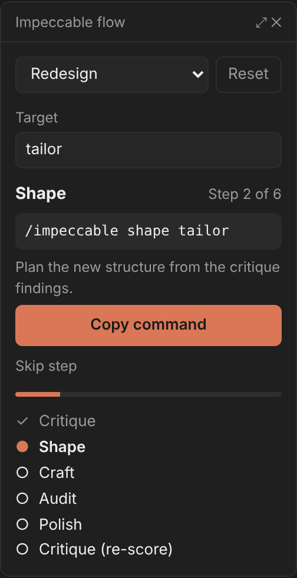
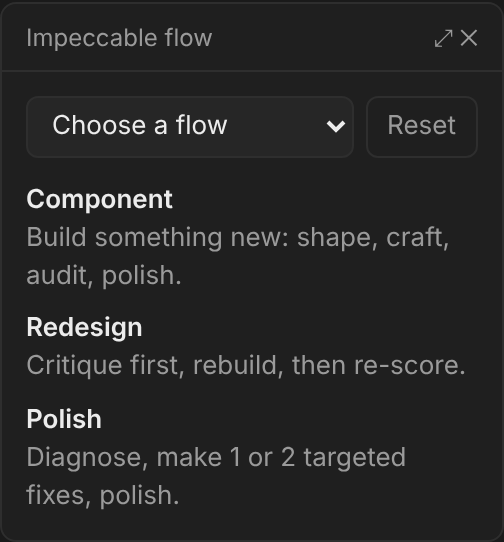
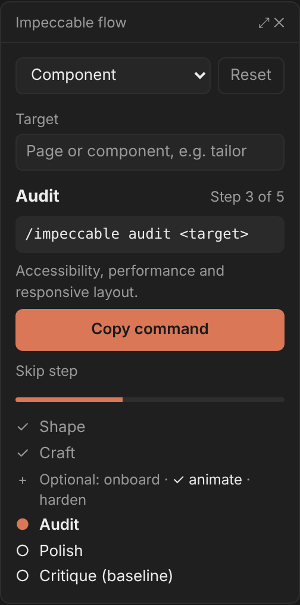
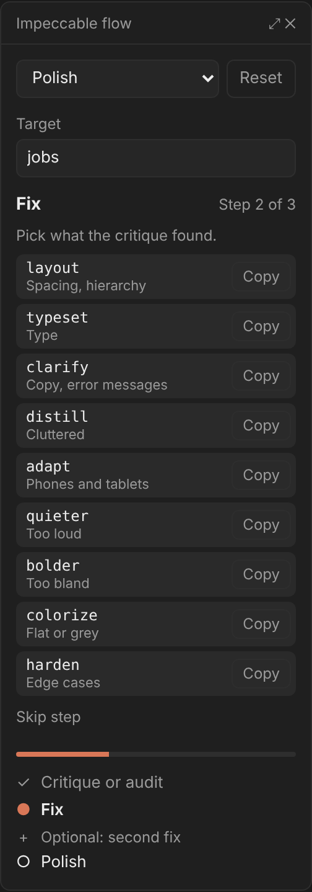
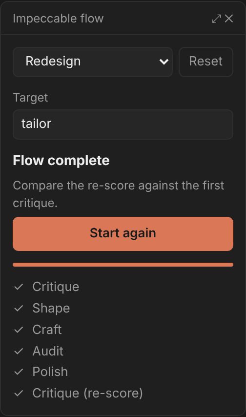

# impeccable-flow

A Claude Code mod that tracks the `impeccable` design lifecycle and tells you which command to run next.

Pick a flow (new component, full redesign or polish), and the mod marks each step as you run `/impeccable <command> <target>`, whether you type it or Claude runs it. It then suggests the next command, with the target filled in.



## The flows

| Flow | Steps |
| --- | --- |
| New component | shape → craft → (onboard, animate, harden) → audit → polish → critique |
| Full redesign | critique → shape → craft → audit → polish → critique again |
| Polish | critique or audit → 1 or 2 targeted fixes → polish |

- `craft` runs `shape` itself, so running `craft` marks both done.
- A second `critique` right after the first is a re-run, not a jump to the final re-score.
- **Skip step** passes over the current step without running it.
- In the polish flow, the fix step lists the targeted commands to choose from: `layout`, `typeset`, `clarify`, `quieter`, `bolder`, `distill`, `colorize`, `adapt`, `harden`.

## Two ways it shows

**Pane** (local sessions in the terminal or the desktop app), top to bottom:

- A **flow dropdown** and a **Reset** button.
- A **Target** field (for example `tailor`). Commands you run also update it.
- The **next step**: its name, "Step 2 of 6", the command with the target filled in, a one-line reason, a **Copy command** button and a quiet **Skip step** button. On the polish flow's fix step, each targeted command has its own Copy button.
- A **progress bar** over the required steps.
- The **step list**: `✓` done, `●` current, `○` to do, `–` skipped. Optional steps share one row: `Optional: onboard · animate · harden`.

A toast says when a step completes. When the flow is done, **Start again** clears progress and keeps the target. On the mobile app the dropdown becomes flow buttons and the target is read-only.

| No flow chosen | Optional steps | Polish fix step | Flow complete |
| --- | --- | --- | --- |
|  |  |  |  |

The images are mockups of the pane's layout and wording. The app draws its own dropdown, field and buttons, so colors and corners follow your theme.

**Text** (sessions that cannot draw a pane, such as cloud sessions): the slash command prints the same information.

```
/impeccable-flow redesign

Redesign: tailor

Next: Shape (step 2 of 6)
  /impeccable shape tailor
  Plan the new structure from the critique findings.

  ✓ Critique
  ● Shape
  ○ Craft
  ○ Audit
  ○ Polish
  ○ Critique (re-score)
```

## Commands

| Command | What it does |
| --- | --- |
| `/impeccable-flow` | Open the pane, or print the flow where no pane can be drawn |
| `/impeccable-flow component` | Choose the new-component flow |
| `/impeccable-flow redesign` | Choose the full-redesign flow |
| `/impeccable-flow polish` | Choose the polish flow |
| `/impeccable-flow reset` | Clear the flow and its progress |

## Install

At the prompt of a terminal session:

```
/plugin install impeccable-flow --marketplace Nirkusan/impeccable-flow-mod
```

Answer `y` to add the marketplace, then pick a scope.

From a shell:

```
claude plugin install impeccable-flow --marketplace Nirkusan/impeccable-flow-mod
```

In the desktop app, where `/plugin` does not run: click + next to the prompt box, then Plugins, Add marketplace with `Nirkusan/impeccable-flow-mod`, then Add plugin.

## Develop

Load it from a local checkout without installing:

```
claude --plugin-dir /path/to/impeccable-flow-mod
```

For a session the desktop app starts, add this to `~/.claude/settings.json`:

```json
{ "env": { "CLAUDE_CODE_PLUGIN_DIRS": "/path/to/impeccable-flow-mod" } }
```

Edits reload by themselves in a session that loads the folder this way.

Run the tests:

```
claude plugin test .
```

The step logic lives in `hooks/flows.ts`; the pane, the slash command and the hooks that record commands are in `hooks/register.tsx`.
